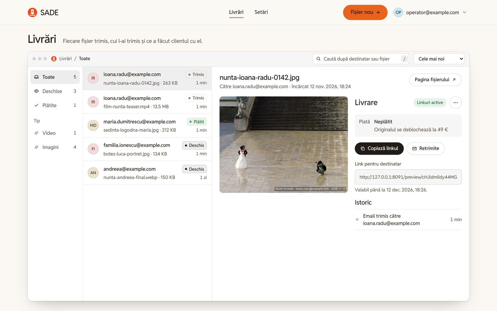
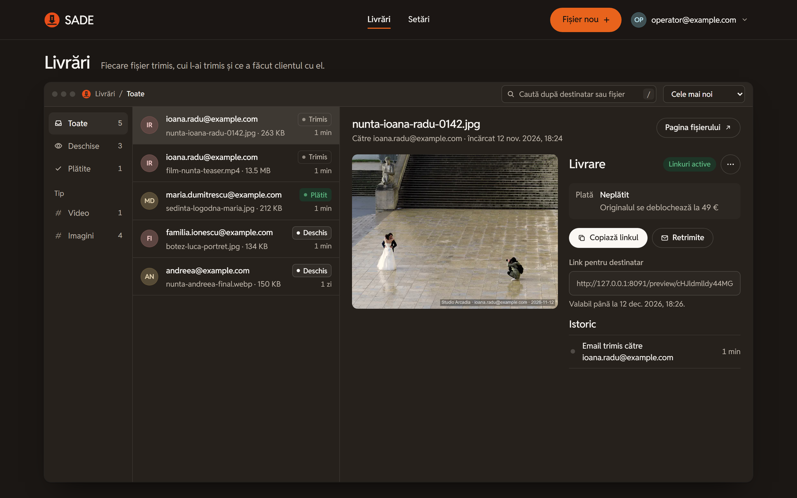
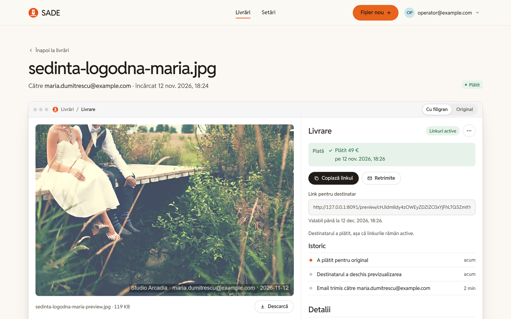
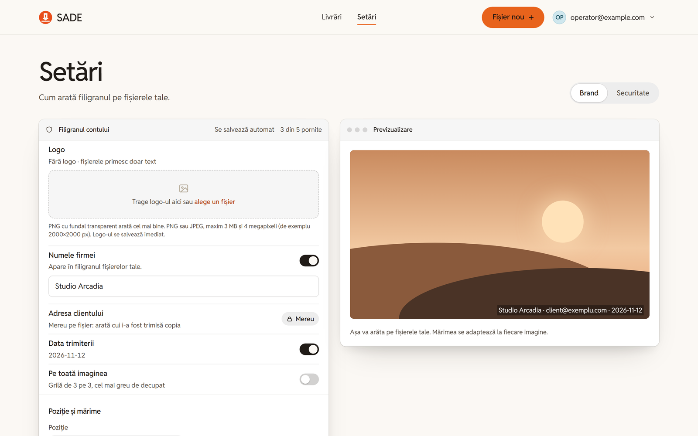
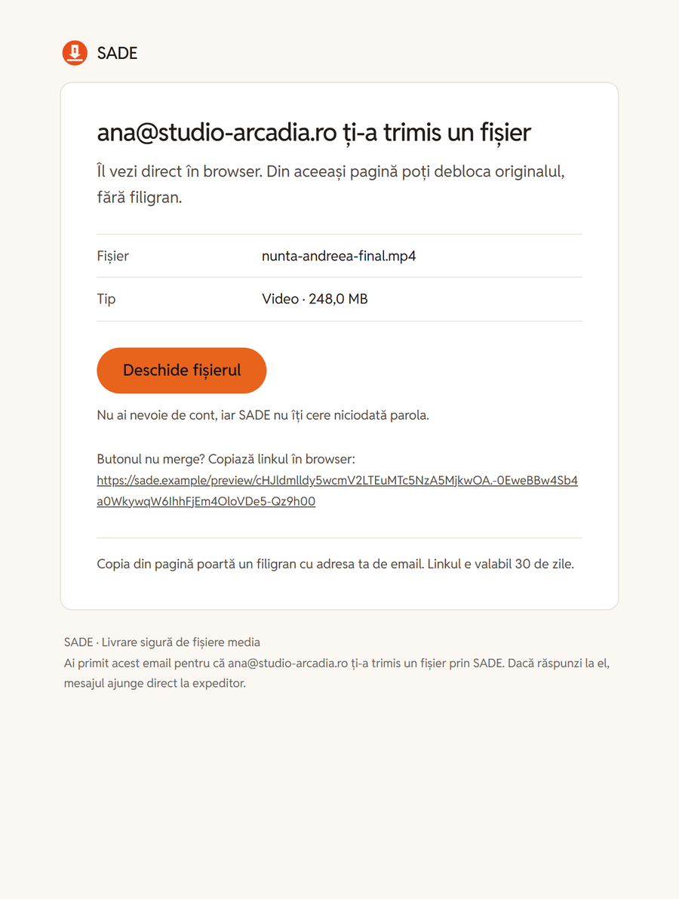
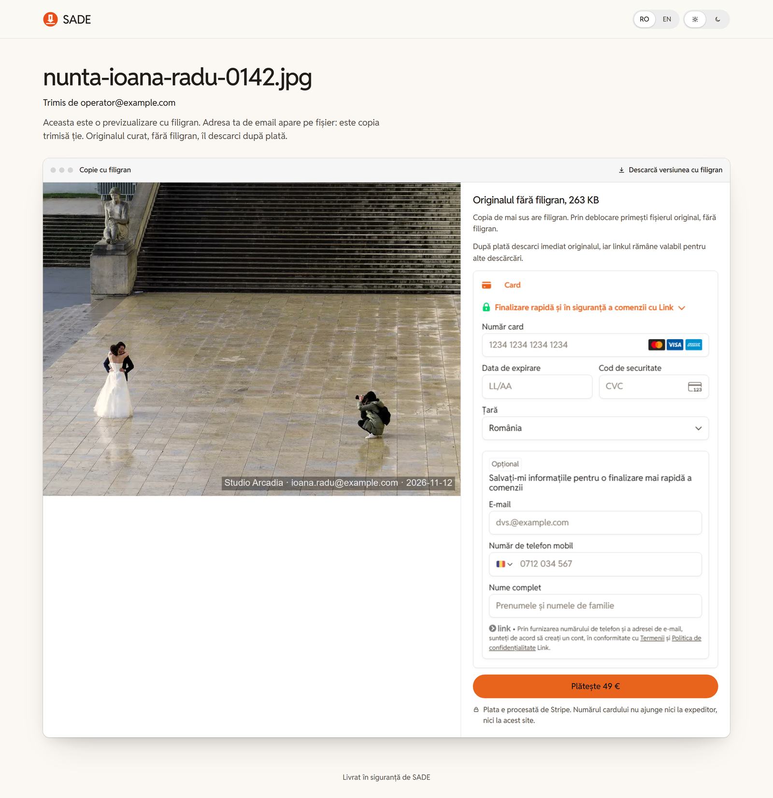
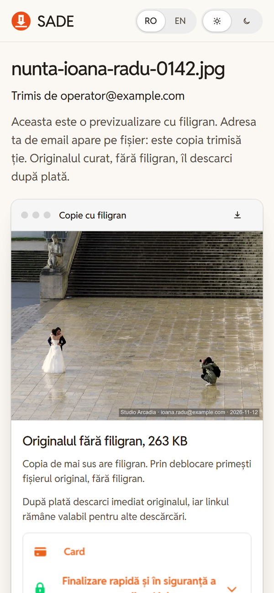
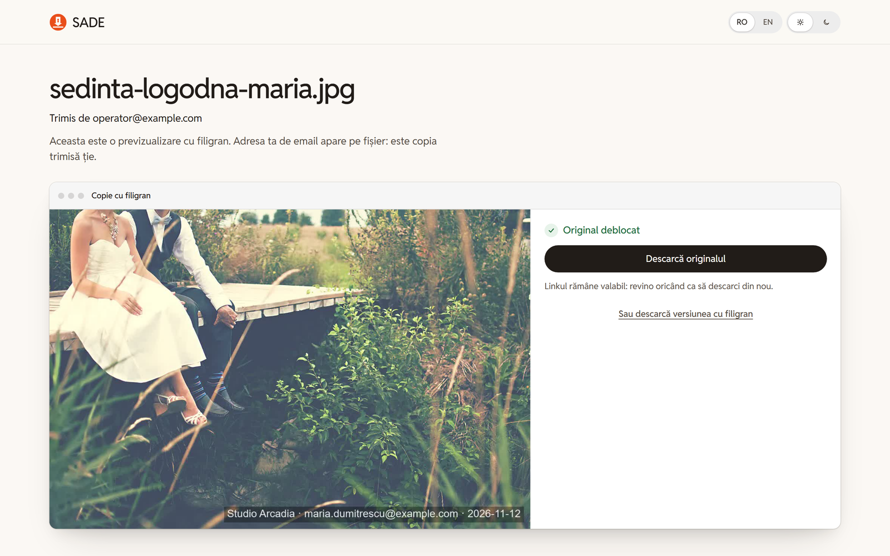

# SADE — Safe Media Delivery

SADE delivers video, audio and image files to an operator's clients with a
watermark that carries the operator's brand **and the recipient's own email
address**, so a leaked copy points to the person it was sent to. The
recipient opens the file in the browser with no account, and can pay
(Stripe, embedded in SADE's own page) to unlock the clean original.

Flow: the operator signs in with a magic link (or a 6-digit code, or a
passkey) → uploads a file and the recipient's address → a worker watermarks
it in the background → the recipient gets one email with a link to their
`/preview/<token>` page → they watch the watermarked copy and, when payments
are on, pay to download the original → the operator sees every step (sent,
opened, paid) on the dashboard, and can copy the link, resend it, or switch
it off.

The interface is Romanian first, with English as the second language.

## Screenshots

**Deliveries** — every file sent, who it went to and what the client did
with it (sent, opened, paid). The list and the open delivery sit side by
side: the watermarked picture, the payment, the recipient's link and the
history.



The same in the dark theme:



**One delivery** — the watermarked copy and the original, the payment row,
copy / resend / switch the links off, and the delivery history.



**Brand** — what goes into every watermark: the logo, the company name, the
date, the whole-picture grid. The client's address is always on, and the
preview shows the result as it will be burned in.



**The email the recipient gets** — who sent the file, what it is, and one
button to the page. Replies go to the operator.



**The recipient's page** — the file name, the verified sender, the
watermarked copy and the Stripe Payment Element, all on SADE's own page.



On a phone:



**Original unlocked** — once the payment clears, the recipient downloads the
clean original.



## Architecture at a glance

- **Backend**: Go, no ORM. `internals/database` wraps two libraries over the
  same `db`-tagged structs — [schema-builder](https://github.com/ciprianiordache/schema-builder)
  migrates the schema at boot, [crud-depot](https://github.com/ciprianiordache/crud-depot) does
  runtime CRUD, plus a small append-only migration list for column changes.
  Postgres in production, SQLite in tests.
- **Frontend**: SvelteKit 2 / Svelte 5, built as a static SPA (`adapter-static`)
  and served by the Go binary itself — one process, one deploy artifact. The
  marketing page (`frontend/static/index.html`) is served at `/`, the app at
  `/app`.
- **Installed app**: the same SvelteKit code built with `npm run build:app`
  and wrapped in Tauri 2 (`frontend/src-tauri`) for Windows, macOS and Linux.
  It signs in with a bearer token instead of a cookie and loads media through
  short-lived signed links. Installers are built by
  `.github/workflows/desktop.yml` and offered on `/descarca`.
- **Worker**: an in-process pool polls for pending jobs and drives them through
  `ffmpeg`/`ffprobe` (shelled out directly, no wrapper library). Every copy
  names its recipient: the brand's template, the operator's own text and the
  logo-only kind all burn the recipient's address in.
- **Payments**: Stripe Elements (a `PaymentIntent` + the client-side Payment
  Element embedded in SADE's own page), not a redirect to Stripe's hosted
  Checkout.
- **Email**: branded HTML + plain text (`internals/emailtmpl`), table-based
  with Outlook-specific markup, the logo embedded as an inline part.

See `CLAUDE.md` for the full per-domain breakdown and the project's decision
history, `PRODUCT.md` and `DESIGN.md` for the product and visual records, and
`docs/SADE-plan.pdf` for the original build plan.

## Prerequisites

- Go 1.22+
- Node 18+ (for the frontend build)
- Docker (for the local Postgres, via `docker-compose.yml`) — or point
  `DATABASE_*` at any Postgres instance you already have
- `ffmpeg` + `ffprobe` on `PATH` (or absolute paths via config) — optional at
  startup: without them the app still serves, uploads just stay `pending`
  forever since nothing watermarks them

## Quick start (development)

```bash
docker compose up -d          # Postgres on host port 5433
go run .
```

On first run, `go run .` generates `config.yaml` and `.env` next to the
binary (defaults layered under `config.yaml`, secrets under `.env`) if they
don't already exist. In an interactive terminal it prompts for required
secrets; non-interactively it writes a `CHANGE_ME` placeholder and refuses to
start until you fill it in. At minimum, set in `.env`:

```
DATABASE_PASSWORD=postgres   # matches docker-compose.yml's POSTGRES_PASSWORD
```

`AUTH_HMAC_SECRET` is self-generated (`generate:"rand32"`) — no action
needed. `MAILER_TRANSPORT` defaults to `log`, so a fresh install works
end to end locally with magic links and preview-ready emails rendered to the
log instead of actually sent; switch it to `smtp` (with `SMTP_*`) to send
real mail.

The Go server listens on `:8080` by default (`SERVER_PORT`). Without a
frontend build, only the JSON API and the public `/p`, `/d`, `/o` share
routes are served.

### Frontend

```bash
cd frontend
npm install
npm run build      # outputs to frontend/build, gitignored
```

`internals/app/static.go` serves `frontend/build` (path configurable via
`APP_FRONTEND_DIR`) with SPA fallback, so `go run .` from the repo root then
serves the whole app — dashboard included — from `http://localhost:8080`.
For frontend-only iteration, `npm run dev` runs a dev server against the Go
API directly (CORS is configured for `http://localhost:5173`).

### Payments (optional)

Payment is entirely opt-in: with no `STRIPE_SECRET_KEY` set, the unlock
section is simply hidden and the rest of the app is unaffected. To exercise
it with Stripe's test mode:

```
STRIPE_SECRET_KEY=sk_test_...
STRIPE_PUBLISHABLE_KEY=pk_test_...
```

Webhook-driven confirmation (needed for a payment to complete when nobody's
page is open to trigger the fallback reconciliation check) additionally
needs `STRIPE_WEBHOOK_SECRET`. Locally:

```bash
stripe listen --forward-to localhost:8080/api/payments/webhook
```

prints the `whsec_...` value to set. A single local tester doesn't strictly
need this — `payment.Service.Status` reconciles a still-pending payment
against Stripe directly on the recipient's own page load.

A job counts as paid once *any* of its payments is paid, so nobody holding
the preview link can reopen checkout and hide a purchase. A paid job refuses
a new checkout (409), and reloading the page reuses the still-open
PaymentIntent instead of creating a new one. A payment counts only if Stripe
reports the full price in the configured currency. The `/o/<token>` link to
the original lasts `PAYMENT_ORIGINAL_LINK_TTL` (default 24h); the recipient's
page mints a fresh one on every visit. The public checkout and status routes
are rate-limited per client IP (`PAYMENT_RATE_LIMIT` per
`PAYMENT_RATE_WINDOW`).

### Accounts, quotas and sign-in

SADE is self-serve by default: anyone who requests a sign-in link gets an
operator account (`AUTH_SIGNUP_MODE=open`). What keeps that safe is a quota
on every operator account (admins are exempt):

```
UPLOAD_JOBS_PER_DAY=25          # jobs per rolling 24h (each one emails a recipient)
UPLOAD_STORAGE_QUOTA_MIB=10240  # originals + previews per account
```

`0` disables either quota. The dashboard shows both as meters
(`GET /api/usage`). An operator frees quota by deleting a job from its
detail page (`DELETE /api/jobs/{id}`). That removes the stored files and
the links already sent. It is refused (409) while the job is processing,
or once a recipient has paid for its original. To restrict who can sign up instead:

```
AUTH_SIGNUP_MODE=allowlist      # or: closed (existing accounts only)
AUTH_SIGNUP_ALLOWED_DOMAINS=studio.example
AUTH_SIGNUP_ALLOWED_EMAILS=someone@else.example
```

A refused address gets the same "link sent" answer as any other, so the
policy can't be used to probe which accounts exist.

Sign-in links open `/auth/confirm#token=...` on the frontend. The token sits
in the URL fragment, so browsers never send it to a server, and nothing
happens until the user clicks "Sign in". That way a mail scanner that
prefetches the link can't spend it, and a link someone else plants can't
quietly sign a visitor into the wrong account. The page calls
`POST /api/auth/verify` (shows the account) and then `POST
/api/auth/complete` (sets the session cookie). Links are limited per
client IP *and* per recipient address (`AUTH_REQUEST_RATE_LIMIT` per
`AUTH_REQUEST_RATE_WINDOW`). The account menu also has "sign out on all
devices" (`POST /api/auth/logout-all`). Changing a user's role ends all of
their sessions.

### Timeouts for large files

`SERVER_READ_TIMEOUT` / `SERVER_WRITE_TIMEOUT` (15s) apply to ordinary API
calls. The upload and every file stream (`/p`, `/d`, `/o`, the operator's own
asset view) get `SERVER_LONG_REQUEST_TIMEOUT` (default 2h) instead, so a
multi-GB upload or a long video download isn't cut off mid-transfer.
`SERVER_READ_HEADER_TIMEOUT` (10s) still bounds slow-header connections on
every route.

### Security headers

Every response carries a Content-Security-Policy that allows only SADE's own
scripts, Stripe.js, and the frontend build's inline bootstrap script, matched
by hash and read from `index.html` at startup (so restart after a frontend
rebuild). It also carries `X-Frame-Options: DENY`, `nosniff`,
`Referrer-Policy`, `Cross-Origin-Opener-Policy` and `Permissions-Policy`.
API responses are `Cache-Control: no-store`. State-changing requests
from a page on another origin are refused with 403 (`Origin` /
`Sec-Fetch-Site` check, on top of `SameSite=Lax`). The Stripe webhook is
the one exemption. Signed `/p`, `/d`, `/o` and `/preview` URLs are logged
as `/p/***`.

### HTTPS

The browser marks `http://` as "not secure", and some of the app genuinely
needs a secure origin to behave: the session cookie is only worth marking
`Secure` over HTTPS, and Stripe refuses to collect card details on a plain
page outside `localhost`. Testing on a LAN address (a phone pointed at
`http://192.168.1.x:8080`) hits both.

**Recommended locally: a Cloudflare quick tunnel.** It terminates TLS at
Cloudflare's edge with a real, publicly trusted certificate and forwards to
the local server, so every device works with nothing installed on it —
unlike a self-signed certificate, whose CA has to be trusted per device.

```powershell
winget install --id Cloudflare.cloudflared   # once
./scripts/tunnel.ps1                         # leave running
go run .                                     # in a second terminal
```

`scripts/tunnel.ps1` waits for the `https://<random>.trycloudflare.com`
hostname Cloudflare assigns and writes it into `.env` as `APP_PUBLIC_URL`,
`APP_FRONTEND_URL` and `SERVER_CORS_ALLOWED_ORIGINS`, plus
`AUTH_SESSION_COOKIE_SECURE=true`. Those must be set **before** the app
starts: `APP_PUBLIC_URL` is what goes into every emailed magic-link and
share link, so a stale value emails links pointing at the old address. Pass
`-NoEnvUpdate` to print the URL without touching `.env`.

A quick tunnel gets a new hostname on every run. For a stable one — which a
Stripe webhook endpoint needs, since it is registered once in the Stripe
dashboard — use a named tunnel on a Cloudflare-managed domain
(`cloudflared tunnel create sade` / `route dns` / `run`).

**Terminating TLS in the Go server instead** (a real certificate, or a
self-signed one for a LAN IP) needs no tunnel:

```
SERVER_TLS_ENABLED=true
SERVER_TLS_CERT_FILE=/path/fullchain.pem
SERVER_TLS_KEY_FILE=/path/privkey.pem
```

#### Behind a proxy

Whenever something else terminates TLS, requests reach the Go server from
loopback over plain HTTP, with the real client in `X-Forwarded-For` and the
real scheme in `X-Forwarded-Proto`. `SERVER_TRUSTED_PROXIES` (default
`127.0.0.1/32,::1/128`) lists the peers whose forwarded headers are
believed; anything else is read from the connection itself, so a client
reaching the server directly can never forge an address past the
`POST /api/auth/request` rate limiter. Set it to your terminator's address
if it is not on this machine, or to nothing at all to disable the trust.

Note that a terminator does not make the local hop HTTPS. `Secure` cookies
and the HSTS header are keyed on the *forwarded* scheme, which is why
`AUTH_SESSION_COOKIE_SECURE=true` is correct behind a tunnel even though
the server itself is answering plain HTTP.

## Commands

```bash
go build ./...
go test ./...
go vet ./...
gofmt -l .
```

```bash
go run ./cmd/watermark -in FILE [-out FILE] [-kind logo|text|both] [-text "..."]
```
runs the watermark engine on one file with a live progress bar — a manual
smoke test of `internals/ffmpeg` independent of the rest of the app; needs
`ffmpeg`/`ffprobe` on `PATH`.

```bash
go run ./cmd/emailpreview -out DIR [-send ADDRESS]
```
renders the three transactional emails (sign-in, new sign-in alert, delivery)
to `.html` files with sample data; `-send` also mails them through the
configured mailer, to see them in a real inbox.

```bash
go run ./cmd/seed          # destructive: empties every table, seeds a demo
go run ./cmd/seed -links   # read-only: prints /preview links for done jobs
```

Frontend (from `frontend/`): `npm run dev`, `npm run build`, `npm run
preview`, `npm run check` (type checking; no separate lint step). The installed
app: `npm run build:app` (static build in `frontend/build-app`), then
`npx tauri build` from `frontend/` (needs Rust; installers land in
`frontend/src-tauri/target/release/bundle`).

## Testing

`go test ./...` runs the full suite, including:

- `internals/app/integration_test.go` — the full model graph (every table,
  every foreign key, `ON DELETE CASCADE`) against a real (SQLite) DB.
- `internals/app/router_test.go` and `internals/app/worker_flow_test.go` —
  real HTTP round trips over `httptest`: login → confirm → cookie →
  `/api/me` → logout, upload → list → detail, a Stripe-mocked checkout →
  unlock, and a full worker run (a fake `ffmpeg.Engine`, no binary needed)
  that claims a real pending job, watermarks it, and delivers a working
  `/p`/`/d` link end to end.
- `internals/app/security_test.go` — the cross-origin guard, a refused
  cross-site upload, sign-out-everywhere, the CSP builder, and log
  redaction of capability URLs.
- Package-local unit tests per domain (`repo`/`service`/`handler`) and
  supporting package (`ratelimit`, `token`, `storage`, `mailer`, `ffmpeg`'s
  argument-building, `worker`'s retry/backoff state machine with fakes).

A few tests that need real `ffmpeg`/`ffprobe` binaries (e.g.
`job.TestCreateVerifiesMediaAgainstExtension`, `ffmpeg.TestWatermarkIntegration`)
skip automatically when those aren't on `PATH`, rather than failing.

## Status

The whole product works end to end: sign-in (magic link bound to the
browser, 6-digit code, passkeys, new-device alerts), brand setup, upload →
watermark with the recipient's address → one email → the recipient's page →
optional paid unlock of the original, plus delivery history, resend and
links on/off for the operator. The web app and the installed desktop app
share one codebase.

Still open: code signing and an updater for the desktop app, iOS and
Android builds, a production deployment (a stable domain for
`APP_PUBLIC_URL` and a registered Stripe webhook), S3 storage, and
operator plans/billing. `CLAUDE.md`'s "Resume here" section has the
detailed log.
